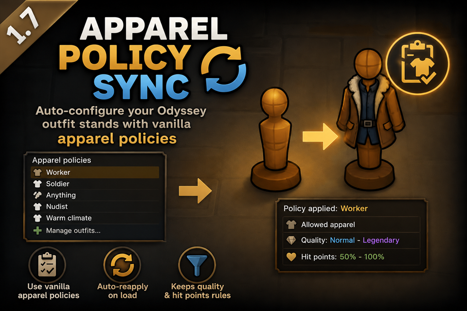

# Wardrobe Policy Sync

Version **1.1.0**. See [CHANGELOG.md](CHANGELOG.md) for changes and
[docs/RELEASING.md](docs/RELEASING.md) for publication preparation.

RimWorld 1.6 and 1.7, Odyssey DLC, Harmony. English and French.

Apply an existing apparel policy to an Odyssey outfit stand: allowed apparel,
quality, durability and special permissions. Reapply or clear it using the
stand commands. Managed stands resync when loading a save; manual stands
remain manual. Policy matching uses its name, so reassign renamed policies.

## Building for 1.7

Requires .NET SDK 10. Run:

```powershell
./build.cmd "D:/SteamLibrary/steamapps/common/RimWorld"
```

An optional second argument supplies the full path to Harmony 1.7's
`0Harmony.dll`. Game paths can also be passed as MSBuild properties
`RimWorldDir` and `HarmonyPath`. The output is `1.7/Assemblies`.
The existing 1.6 binary is preserved in `1.6/Assemblies`.

Run the structural checks after building:

```powershell
powershell.exe -NoProfile -ExecutionPolicy Bypass -File ./tools/check-consistency.ps1 -RimWorldDir "D:/SteamLibrary/steamapps/common/RimWorld"
```

These checks cover XML, version folders, translations and the HAR patch target.
They do not replace the in-game checks in `docs/TESTING.md`.

To rebuild, check and deploy a local test copy with the game closed:

```powershell
powershell.exe -NoProfile -ExecutionPolicy Bypass -File ./tools/deploy-test.ps1
```

Optional parameters: `-RimWorldDir`, `-RimWorldModsDir`, `-HarmonyPath`.
Only runtime files are copied into `Mods/Wardrobe-Policy-Sync`. An existing
installation is backed up outside Mods in `WPS-test-backups` and restored
if deployment fails. This does not activate the mod or publish to Workshop.

## Folder migration

`LoadFolders.xml` loads `Common` and the matching version folder. It does not
load the old root `Assemblies`, `Textures` or `Languages` directories. After
applying the update, Git will show the old tracked paths as deleted and the
new paths as added. Old leftover runtime files at these root paths are ignored.

## Humanoid Alien Races (optional)

HAR adds the race, body and head selectors and deliberately hides the separate
kid stand. On 1.7, this mod removes the adult stand's fixed child-apparel
restriction when HAR is present. HAR's body selector then controls age filters.
Applying a policy preserves its exclusions and also excludes apparel unsuitable
for the selected body. A policy must allow child apparel to use it.
Missing race-command icons use the existing policy icon as a fallback.
Without HAR, vanilla adult and kid stands keep their separate restrictions.

No defNames or save keys were changed. The user reported successful in-game
tests of the deployed 1.7 build on 27 November 2026. See `docs/TESTING.md`
for the validation record and test scenarios.


